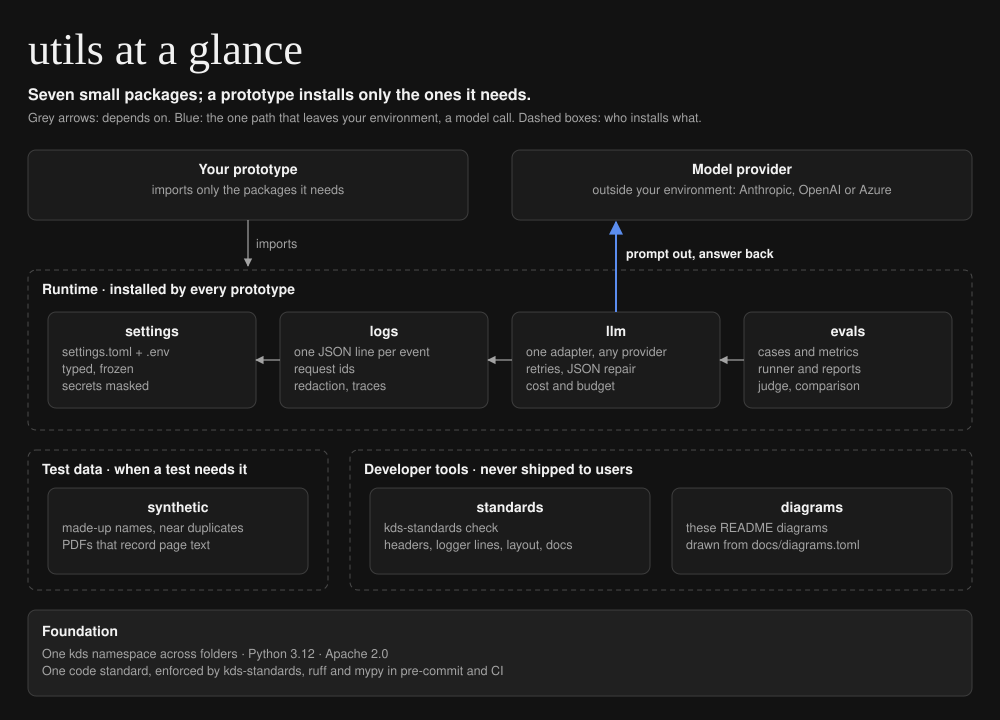
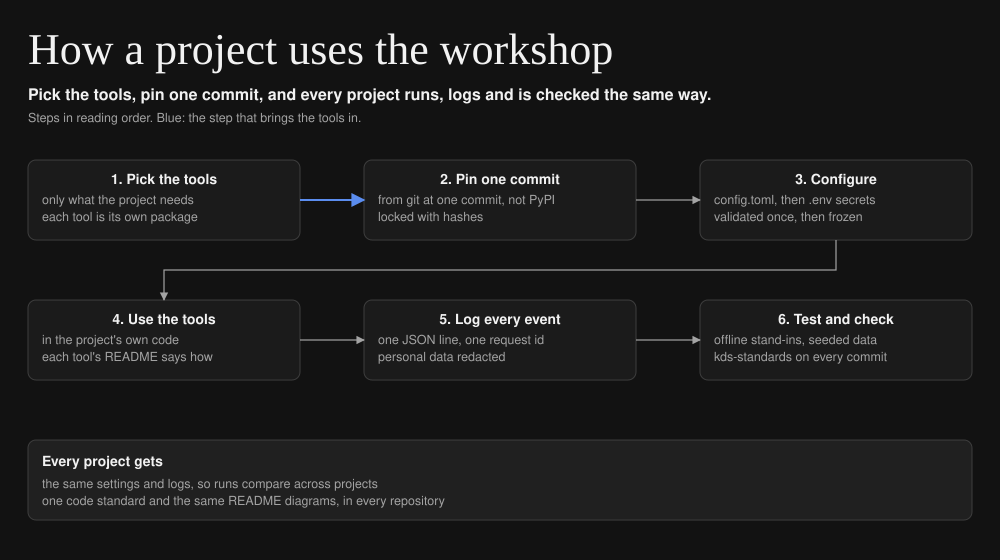

# utils

[](https://github.com/iamkevinstreet/utils/actions/workflows/ci.yml) [](https://github.com/iamkevinstreet/utils/actions/workflows/codeql.yml) [](LICENSE)

My workshop: the tools I've collected over time and reach for on every project. Each tool is a
small Python package that a project installs on its own, so every project takes only what it needs.

## Status

Release **v0.3.0**. Every package is in use by the projects below; 78 tests pass offline in CI, with
strict mypy and no kds-standards findings. Tools are added as projects need them, and each
package's README says what is next for it.

## Quick start

Needs Python 3.12 and [uv](https://docs.astral.sh/uv/). Nothing to set up: the defaults run
offline.

```sh
git clone https://github.com/iamkevinstreet/utils.git && cd utils
make install          # .venv from the hashed lockfile
make check test       # lint, strict types, the code standard, then every test
```

## Installing a package

A project installs only the packages it uses, each from git at one commit SHA, so nothing changes
underneath it. List every kds package the ones you use depend on (`kds-logs` needs
`kds-settings`), all at the same commit. With uv, in the project's `pyproject.toml`:

```toml
[project]
dependencies = ["kds-settings", "kds-logs"]

[tool.uv.sources]
kds-settings = { git = "https://github.com/iamkevinstreet/utils", subdirectory = "settings", rev = "<commit>" }
kds-logs = { git = "https://github.com/iamkevinstreet/utils", subdirectory = "logs", rev = "<commit>" }
```

None of these packages is on PyPI. A kds name left to the default index could resolve to a
stranger's package, so `uv.lock` must show every kds package coming from this repository. The
commits behind each release are in [CHANGELOG.md](CHANGELOG.md).

## Architecture at a glance



| Package | Import | What it does | Depends on |
| --- | --- | --- | --- |
| [settings](settings/) | `kds.settings` | typed, frozen settings from `config/settings.toml` and `.env` | pydantic |
| [logs](logs/) | `kds.logs` | JSON-lines logs, request ids, redaction, trace lines | settings |
| [llm](llm/) | `kds.llm` | one adapter for model providers, with an offline stand-in | settings, logs |
| [evals](evals/) | `kds.evals` | cases, metrics, a runner and reports | llm, logs |
| [synthetic](synthetic/) | `kds.synthetic` | made-up names, near duplicates, PDFs that record page text | reportlab, pypdf |
| [standards](standards/) | `kds.standards` | `kds-standards`: holds a repository to one code standard | none |
| [diagrams](diagrams/) | `kds.diagrams` | `kds-diagrams`: draws these diagrams from TOML | none |

## How it works



1. **Pick the tools.** A project installs only the packages it uses, and any repository can use
   the developer tools, whatever its language.
2. **Pin one commit.** Every package comes from git at one reviewed commit, locked with hashes, so
   nothing changes underneath the project (see [installing a package](#installing-a-package)).
3. **Configure.** `kds.settings` reads `config/settings.toml`, then secrets from `.env`;
   environment variables override both. It validates everything once and freezes it.
4. **Use the tools.** Each package's README says what it does, how to use it and the settings it
   reads; model calls are covered in [llm/README.md](llm/README.md).
5. **Log every event.** `kds.logs` writes one JSON line per event with a request id, and redacts
   personal data before anything is written.
6. **Test and check.** Seeded test data and offline stand-ins keep tests deterministic;
   `kds-standards` checks every commit, and `kds-diagrams` draws the README diagrams.

## Design

- **Context.** Every project needs the same groundwork: settings, logs, test data, a standard to
  hold to, diagrams for its README. Copies of that groundwork in each project drift apart, and a
  fix has to be made in every copy. This repository is where the tools live instead: collected
  over time, tested once, and used everywhere.
- **Requirements.** Useful to any project; install only what is used; one tested way to do each
  common job; traceable runs; no secrets in config or logs; offline, deterministic tests.
- **Options considered.** Copying the code into each project; one large package; an outside
  framework; small packages in one namespace. The last was chosen: each project pulls only the
  dependencies of the tools it uses, and a fix lands once.
- **Test plan.** Every package's tests run offline in CI with warnings as errors, and each package
  tests its own failure paths.
- **Rollout.** Each release is a changelog entry naming the commit projects pin; a project moves to
  a new release in its own pull request.

## Results

This repository has no evaluation of its own; its packages produce the results tables in each
project that uses them:

| Project | Repository |
| --- | --- |
| EEOC charge intake: extraction with source spans and human review | [eeoc-charge-intake](https://github.com/iamkevinstreet/eeoc-charge-intake) |
| Grounded Q&A over approved sources, with abstention | [grounded-qa](https://github.com/iamkevinstreet/grounded-qa) |
| New-matter intake agent with scoped tools and approval gates | [intake-conflicts-agent](https://github.com/iamkevinstreet/intake-conflicts-agent) |

Case studies with the evaluation plans and results: https://kevindstreet.com/projects/

## Configuration

Every shared setting, with its default, is in [config/settings.toml](config/settings.toml); a test
fails if that file and the defaults in code drift apart. Secrets are only ever in `.env` (names in
[.env.example](.env.example)). [settings/README.md](settings/README.md) says how a value is chosen,
and each package's README lists the settings it reads: [logs](logs/README.md) and
[llm](llm/README.md).

## Operating it

- **Logs.** A service calls `setup_logging()` once at startup. Every event is one JSON line in
  `<log dir>/YYYY-MM-DD.jsonl` and on stderr, with a timestamp, level, logger, request id and the
  event's fields, redacted by default.
- **Following one request.** Every line carries a request id; filter on it to see one request or one
  evaluation case from start to finish.
- **Tracing a run.** `kds-standards trace on <path>` turns the logger lines on; with
  `[log] trace = true` they print as `00:00:02 - Splits the question into search terms`.
  `kds-standards trace off <path>` turns them off again before you commit.
There is no service to run here, so there is no runbook; each project that runs one has its own.

## Testing

```sh
make test     # 78 tests, offline, warnings as errors
make check    # ruff, strict mypy and kds-standards
make audit    # pip-audit over every locked dependency
```

The tests are deterministic: offline stand-ins take the place of anything outside the process,
test data comes from fixed seeds, waits are injected, every file goes to a temporary folder, and the
root `conftest.py` gives every test the defaults, with no settings file and its logs in a temporary
folder.

## Security

Secrets live only in `.env`, and the settings loader refuses one in `settings.toml`. Logs redact
personal data by default. Dependencies are locked with hashes and audited in CI; Actions are pinned
to commit SHAs; gitleaks scans every commit and the whole history; CodeQL scans the code. To report a
vulnerability, see [SECURITY.md](SECURITY.md).

## Project layout

```
utils/
├── settings/      kds.settings: settings.toml and .env, typed and frozen
├── logs/          kds.logs: JSON lines, request ids, redaction, traces
├── llm/           kds.llm: the model adapter, providers, pricing
├── evals/         kds.evals: cases, metrics, runner, reports, judge
├── synthetic/     kds.synthetic: made-up names and PDFs
├── standards/     kds.standards: the kds-standards checker
├── diagrams/      kds.diagrams: the kds-diagrams renderer
├── config/        settings.toml: every shared setting at its default
├── docs/          diagrams.toml and the two SVGs it draws
└── .github/       CI, CodeQL, Dependabot, CODEOWNERS
```

Each package folder holds its own `pyproject.toml`, `README.md`, `kds/<name>/` and `tests/`. All of
them share the `kds` namespace, so a project imports `from kds.logs import get_logger` whichever
packages it installed. Tests run from the root, where `pyproject.toml` puts every package on the
path.

## Changelog and license

Releases are listed in [CHANGELOG.md](CHANGELOG.md). Every file follows one code standard, which
`kds-standards` checks in pre-commit and CI.

Parts of this repository were drafted with AI coding assistants. Every change was read, run and
tested before it was kept.

Apache License 2.0. See [LICENSE](LICENSE) and [NOTICE](NOTICE).
